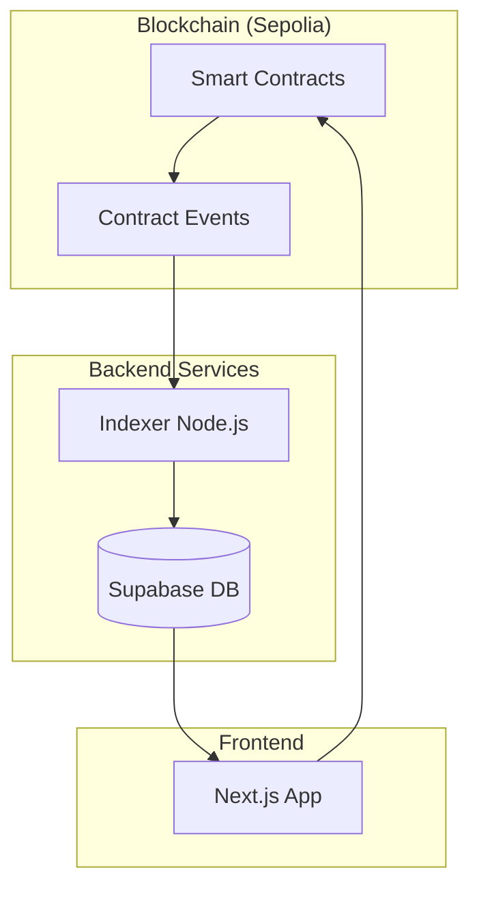

# Marketplace — Production-Grade NFT Marketplace


A production-grade, high-performance NFT marketplace with a modular three-contract architecture (Core + Bids + Router), a Viem-based event indexer with provider pooling, and a Next.js 16 frontend with optimistic UI and Supabase Realtime. Deployed on Sepolia.

## 🎯 Why This Project Exists

Directly querying the blockchain for marketplace data (like listing all NFTs or searching for collections) is slow and provides a poor user experience.

This project solves this by implementing an **Event Indexing Pattern**:

1. **Indexer**: Continuously monitors the blockchain for specific smart contract events.
2. **Database**: Persists these events into a relational database (Supabase) in a query-optimized format.
3. **Frontend**: Queries the database for fast reads while interacting with smart contracts for writes.

This ensures an instantaneous UI while maintaining the decentralization and security of the Ethereum blockchain.

## ✨ Features

- 🛒 **NFT Marketplace**: Complete flow for listing, bidding, and purchasing NFTs.
- ⚡ **High-Performance Indexer**: Viem-based indexer that polls blockchain events and keeps the database in sync.
- 🛡️ **Type-Safe Infrastructure**: Shared domain types and ABIs across the entire monorepo, ensuring consistency between the indexer and frontend.
- 🏗️ **Modular Monorepo**: Powered by Turborepo for optimized build pipelines and shared configuration.
- 🌐 **Sepolia Integration**: Fully deployed and tested on the Ethereum Sepolia testnet.
- ⚡ **Modern Frontend**: Built with Next.js 16 App Router, Wagmi, and React Query for a seamless Web3 experience.

## 🏗️ Deployed Contracts (Sepolia)

| Contract | Address | Etherscan |
|----------|---------|-----------|
| `Marketplace` (router) | `0x55495153De44570DFC37B2daC4Bc13241B3C2e87` | [View](https://sepolia.etherscan.io/address/0x55495153De44570DFC37B2daC4Bc13241B3C2e87) |
| `MarketplaceCore` | `0x36052B33e4f10E3264B89961EC3873374Fedc793` | [View](https://sepolia.etherscan.io/address/0x36052B33e4f10E3264B89961EC3873374Fedc793) |
| `MarketplaceBids` | `0x613CeD51Fd25F67FEcc0c5C22981d42397eddFb1` | [View](https://sepolia.etherscan.io/address/0x613CeD51Fd25F67FEcc0c5C22981d42397eddFb1) |

## 🛠 Tech Stack

### Frontend

- **Framework**: Next.js 16 (App Router)
- **Web3**: Wagmi, Viem, React Query
- **Styling**: Tailwind CSS
- **State Management**: React Context / React Query

### Backend & Indexing

- **Runtime**: Node.js
- **Indexer**: Viem (Blockchain event polling)
- **Database**: Supabase (PostgreSQL)
- **Client**: Supabase JS SDK

### Tooling

- **Monorepo**: Turborepo, pnpm
- **Language**: TypeScript
- **Linting/Formatting**: ESLint, Prettier

## 📐 Architecture

The project follows a decoupled architecture where the blockchain acts as the source of truth, but the database serves the read-heavy frontend.



### Core Components

- **`apps/web`**: The user-facing marketplace. It reads from Supabase and writes to the blockchain.
- **`apps/indexer`**: A dedicated worker that listens to blockchain events and updates the database.
- **`packages/contracts`**: The single source of truth for ABIs and contract addresses.
- **`packages/shared`**: Universal domain types and constants used by both the indexer and web app.
- **`packages/database`**: Server-side database repositories used by the indexer for secure writes.

## 📂 Repository Structure

```text
marketplace/
├── apps/
│   ├── web/           # Next.js 16 frontend
│   └── indexer/       # Viem-based blockchain event indexer
├── packages/
│   ├── contracts/      # ABIs & deployed contract addresses
│   ├── shared/         # Domain types + universal constants
│   ├── database/      # Supabase client factory + typed repositories
│   └── config/         # Shared tsconfig & ESLint configs
├── docs/               # Architecture, conventions, and roadmap
├── turbo.json          # Turborepo pipeline configuration
└── pnpm-workspace.yaml # pnpm workspace definition
```

## 🚀 Getting Started

### Prerequisites

- **Node.js**: `>=18`
- **pnpm**: `>=9`
- **Supabase Account**: For database and authentication.
- **RPC Provider**: (e.g., Alchemy or Infura) for blockchain connectivity.

### Installation

1. **Clone the repository**

   ```bash
   git clone https://github.com/Carl0xFabCol/nft-marketplace.git
   cd nft-marketplace
   ```

2. **Install dependencies**
   ```bash
   pnpm install
   ```

### Environment Variables

Create `.env` files in the respective app directories.

#### `apps/web/.env`

| Variable                        | Description                   |
| :------------------------------ | :---------------------------- |
| `NEXT_PUBLIC_SUPABASE_URL`      | Your Supabase project URL     |
| `NEXT_PUBLIC_SUPABASE_ANON_KEY` | Your Supabase anon public key |

#### `apps/indexer/.env`

| Variable               | Description                                  |
| :--------------------- | :------------------------------------------- |
| `SUPABASE_SERVICE_KEY` | Supabase service_role key (admin access)     |
| `RPC_URL`              | Your Ethereum RPC provider URL               |
| `ETHERSCAN_API_KEY`    | Optional: Etherscan API key for verification |

## 🛠 Development

### Available Scripts

| Command                | Description                                 |
| :--------------------- | :------------------------------------------ |
| `pnpm dev`             | Runs all apps in development mode via Turbo |
| `pnpm build`           | Builds all projects                         |
| `pnpm lint`            | Runs linting across the monorepo            |
| `pnpm dev:web`         | Starts only the frontend                    |
| `pnpm dev:indexer`     | Starts only the indexer                     |
| `pnpm build:contracts` | Builds the contracts package                |

### Running the Project

To start the entire stack:

```bash
pnpm dev
```

### Docker (One-Command Local Dev)

For a full local environment (web + indexer + local Supabase), use Docker Compose:

```bash
cp apps/web/.env.example apps/web/.env.local
cp apps/indexer/.env.example apps/indexer/.env
docker-compose up --build
# Web: http://localhost:3000
# Indexer logs: docker-compose logs -f indexer
```

The Docker setup includes a local Supabase stack (Postgres + Realtime) for development.
See `docker-compose.yml` for configuration details.

## 📚 Documentation

| Document | Description |
|----------|-------------|
| [Architecture](docs/ARCHITECTURE.md) | Full system architecture, data flows, trade-offs |
| [Smart Contracts](docs/CONTRACTS.md) | Three-contract design, security patterns, gas optimizations |
| [Indexer](docs/INDEXER.md) | Provider pooling, batching, handler registry, crash recovery |
| [Frontend](docs/FRONTEND.md) | Optimistic UI, realtime, batch operations, SIWE auth |
| [ADR-001](docs/adr/001-modular-contracts.md) | Why three contracts (Core/Bids/Router) |
| [ADR-002](docs/adr/002-event-indexing.md) | Event-driven indexing strategy |
| [ADR-003](docs/adr/003-optimistic-ui.md) | Optimistic UI with idempotent reconciliation |

## 🗺 Roadmap

- [ ] **Performance**: Implement queue-based indexing (e.g., BullMQ) for better reliability.
- [ ] **Code Quality**: Implement comprehensive test suite (Unit & Integration).
- [ ] **Refactor**: Decompose the `hooks/Contract.ts` god-file into domain-specific hooks.
- [ ] **Multichain**: Support for multiple EVM chains.
- [ ] **CI/CD**: GitHub Actions for automated testing and deployment.

## 🤝 Contributing

Contributions are welcome! Please follow these steps:

1. Fork the repository.
2. Create a feature branch: `git checkout -b feature/AmazingFeature`.
3. Commit your changes: `git commit -m 'Add some AmazingFeature'`.
4. Push to the branch: `git push origin feature/AmazingFeature`.
5. Open a Pull Request.

## 📄 License

This project is licensed under the MIT License - see the LICENSE file for details.
